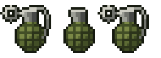

# Grenade

**Version 0.2.0** for Half Grip 0.419, a [HalfGripTools](https://github.com/4l3x4nd3r0/HalfGripTools) mod (1.0.6 or newer).

Hand grenades for your gun slot. With grenades fitted no gun hangs by the visor: instead, three grenades sit on the dash where the
ammo goes. Pull a pin with the cockpit hand, then grab the grenade and throw it out of the car with a flick of the mouse. It
bounces, rolls, and goes off when its fuse runs out: 80 damage close in. There is no holding the spoon down, so once the pin is out,
the clock is running.



## Using it

1. **Pull the pin.** Hold the left button on a grenade's ring and pull it away. It gives a little, then comes out: the spoon flies
   off and the fuse starts hissing. You have **3.5 seconds**.
2. **Grab the grenade** (the left button again) and **flick it**:
   - **Flick up** and let go to throw it **ahead** of the car. The faster the flick, the further it goes.
   - **Flick down** and let go to toss it **back** over the roof, at whoever is behind you.
   - It goes the way you **point**: let go with the hand over a car and the grenade heads for it. A **sideways** flick throws it out of
     the side window.
   - Your car's speed is added to the throw, so at speed a grenade thrown ahead lands a long way ahead.
3. Let go **too slowly** and you have dropped it in the car. Catch it before it falls out of sight, or it goes off in the footwell.
   A grenade that goes off in the car, in your hand, on the dash or in the footwell does **80 damage to your car**.

A grenade with its pin still in is just ammo: grab it, put it back, nothing happens. You cannot pull pins during the opening
ceasefire (the padlock is on the grenades, as on other ammo). Ammo boxes top the grenades back up to three, and items that give you
extra magazines give you extra grenades.

The grenade is a **Race-Spec gun card, cost 40**. Its blast does full damage out to about a car length and nothing past two and a half,
and a car it wrecks counts as your kill. It hurts your own car too if it goes off near you (`Grenade.SelfDamage`).

## Multiplayer

Works with the [Multiplayer](https://github.com/4l3x4nd3r0/HalfGripMods) mod (everybody in the room needs the Grenade, as with any
mod there). The other players see your grenades fly, hear them hiss and see them go off. A grenade that catches another player's car
hurts it by the host's **ExplosionDamage** setting, like a rocket, and shoves it as it shoves AI cars (not when the host has set
explosions to no damage); your own settings (`Grenade.Damage`, the radii) decide your blasts.

## Install

### Easy way: the HalfGripMods installer

1. Download `HalfGrip-Mods-Installer.exe` from the newest release of
   [HalfGripMods](https://github.com/4l3x4nd3r0/HalfGripMods/releases) and double-click it. If Windows says "Windows protected
   your PC", press **More info**, then **Run anyway**. It finds the game through Steam (or asks for its folder) and installs
   BepInEx and HalfGripTools for you.
2. Close the game. Press **+ ADD** and paste this link to the mod's folder:
   ```
   https://github.com/htubdawg/HalfGripGrenade/tree/main/Grenade
   ```
   Then press **INSTALL** on the Grenade's card.
3. Start the game from Steam. The first start takes a little longer while the mods compile.

**CHECK NOW** in the installer looks for updates.

### By hand

Install BepInEx 5 and [HalfGripTools](https://github.com/4l3x4nd3r0/HalfGripTools) 1.0.6+ as its README says. Then copy only the
`Grenade` folder into `<game>\BepInEx\HalfGripMods\`, so that `mod.json` sits directly in `HalfGripMods\Grenade\`, not the whole
repository download.

## Settings

`BepInEx\config\halfgrip.grenade.cfg`. Distances are in game units: a car is about 13 long.

| Setting | Default | |
|---|---|---|
| `Grenade.Damage` | 80 | Damage to a car close to the blast |
| `Grenade.FullDamageRadius` | 13 | Full damage out to this far from the blast |
| `Grenade.BlastRadius` | 32 | No damage past this; in between it falls off evenly |
| `Grenade.FuseSeconds` | 3.5 | From pulling the pin to the blast |
| `Grenade.SelfDamage` | true | A thrown grenade also hurts your car when it goes off near you |
| `Grenade.CockpitDamage` | 80 | Damage to your car when a grenade goes off inside it (0: none) |
| `Grenade.Grenades` | 3 | Grenades on the dash (1 to 3) |
| `Grenade.PinPull` | 0.5 | How far to pull the ring before the pin comes out (cockpit units) |
| `Grenade.Cost` | 40 | The card's price (from the next start) |
| `Throw.SpeedPerFlick` | 11 | Throw speed for each screen height a second of flick: higher throws further |
| `Throw.MinThrowSpeed` | 7 | Let go slower than this and it drops in the car |
| `Throw.MaxThrowSpeed` | 60 | The hardest throw, on top of the car's speed |
| `Throw.LoftDegrees` | 22 | The angle above level it leaves at |
| `Throw.Gravity` | 30 | How fast a thrown grenade falls |
| `Dash.OffsetX` / `OffsetY` | 0 | Move the grenades on the dash (cockpit units, a cockpit pixel is about 0.05) |
| `Debug.VerboseLog` | false | Write what the mod finds and does to `BepInEx\LogOutput.log` |
